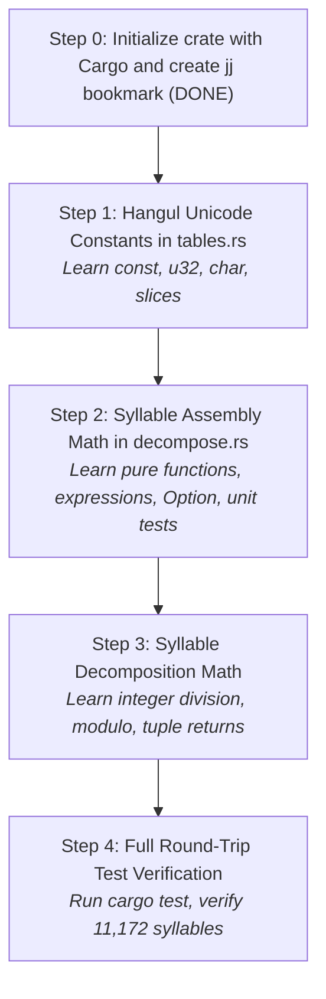

# Native Rust Port: Architecture & Setup Plan

## Goal Description

Establish the long-term project scaffolding, version control structure using **Jujutsu (`jj`)**, and a **living progress tracking system** to guide you step-by-step as you type and learn Rust.

This plan details:
1. Version control bookmarking (`jj bookmark create native-rust-port`).
2. Directory structure for the Rust core library alongside the existing web codebase.
3. The living progress tracker artifact structure and update cadence.
4. The exact protocol for our driver–navigator interactions.

---

## 1. Version Control & Jujutsu (`jj`) Bookmark Strategy

To keep the Rust port completely isolated from the current web production branch (`main`), we will create a dedicated Jujutsu bookmark named **`native-rust-port`**.

### Current VCS State:
- `main` bookmark is at commit `4c7f4823`.
- The current working revision `@` is tracked on bookmark `native-rust-port`.

---

## 2. Repository Layout & Rust Workspace Setup

We place the Rust codebase in a dedicated workspace within this repository, ensuring it does **not** interfere with Vite, ESLint, or npm:

```
korean-typing-tutor/
├── src/                           # Existing Svelte / Web application (untouched)
├── crates/
│   ├── korean-typing-core/        # Pure Rust library crate (Hangul math, IME, mastery)
│   │   ├── Cargo.toml
│   │   └── src/
│   │       ├── lib.rs             # Crate root
│   │       ├── tables.rs          # Phase 1: Unicode constants & maps
│   │       ├── decompose.rs       # Phase 1: Syllable arithmetic
│   │       ├── engine.rs          # Phase 2: Hangul IME state machine
│   │       └── mastery.rs         # Phase 3: Rolling window & spaced repetition
│   │
│   └── korean-typing-desktop/     # Phase 6: Native Desktop App (Slint GUI)
│       ├── Cargo.toml             # slint dependency & build.rs
│       ├── build.rs               # slint_build::compile("ui/appwindow.slint")
│       ├── ui/
│       │   ├── appwindow.slint    # Main window & layout
│       │   ├── virtual_key.slint  # Keycap with liquid mastery gauge
│       │   └── target_text.slint  # Giant target display & subtext
│       └── src/
│           └── main.rs            # Slint event loop & keystroke routing
├── Cargo.toml                     # Root Cargo workspace manifest
├── .gitignore                     # Ignores Cargo's target/
└── package.json                   # Existing npm scripts (untouched)
```

Adding `target/` to `.gitignore` ensures Rust build artifacts never pollute git/jj revisions.

---

## 3. Progress Tracking

We maintain a dedicated, living progress tracker file:
- **Location**: `design-docs/rust-port/PROGRESS.md`.
- **Contents**:
  - Current Phase & Step.
  - Rust Concepts Mastered (cheat sheet of concepts learned so far).
  - Test Suite Status (`cargo test` pass/fail counter).
  - Milestone Checklist (Phases 1 through 6).
  - Next Driver Exercise (the exact prompt/goal for your next typing session).

---

## 4. Phase 1 Roadmap (Your First Rust Steps)



---

## 5. Verification Commands

### Rust Verification
```bash
cargo test
cargo clippy
```

### Web Verification
The existing web test suite must remain 100% green and unaffected:
```bash
npm test
npm run lint
```
