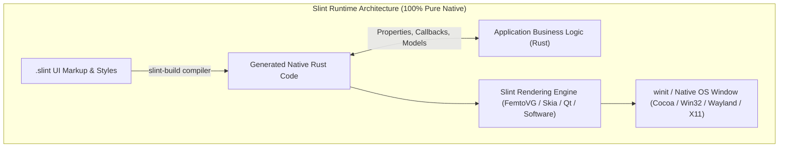

# Slint vs. Tauri: Architectural Deep-Dive & Practical Comparison

## Goal Description

Explain what **Slint** and **Tauri** are, how their internal architectures function, how their developer experiences and runtime profiles compare, and how each applies specifically to building a native desktop version of the Korean Typing Tutor on **macOS**, **Windows**, and **Linux**.

---

## 1. What is Slint?



### Background & Origins
**Slint** (formerly named *SixtyFPS*) was created by **Olivier Goffart** and **Simon Hausmann**, two former core engineers and architects of the **Qt framework** and KDE. They recognized that while Qt was powerful, it carried decades of C++ legacy baggage and was too heavy for modern resource-constrained environments. They set out to build a lightweight, native GUI toolkit designed from scratch in **Rust**.

### How Slint Works
Slint divides an application into two layers:
1. **The UI Layer (`.slint` files)**: A declarative markup language that feels like a clean blend of QML, CSS, and Svelte. You define components, layouts, reactive property bindings, and state transitions.
2. **The Logic Layer (Rust)**: Your standard Rust application code. Slint’s build script (`slint-build`) compiles `.slint` files into native, type-safe Rust structs at compile time.

There is **no web browser, no DOM, and no JavaScript runtime** anywhere in the system.

### Rendering Pipeline
Slint renders directly to the screen via hardware-accelerated 2D vector engines:
- **FemtoVG / OpenGL / Vulkan / Metal**: Direct GPU vector graphics via OpenGL or `wgpu`.
- **Skia Backend**: High-performance 2D engine (the same engine powering Chrome and Flutter).
- **Software Renderer**: Can render with zero GPU dependencies (ideal for headless or low-end systems).

### Slint Code Example for Korean Tutor (Virtual Keycap)

```slint
// VirtualKey.slint
export component VirtualKey inherits Rectangle {
    in property <string> primary_char;
    in property <string> shift_char;
    in property <float> mastery_progress: 0.0; // 0.0 to 1.0
    callback clicked();

    width: 48px;
    height: 48px;
    border-radius: 4px;
    background: #27272a; // Tailwind zinc-800
    border-width: 1px;
    border-color: #3f3f46;

    // Liquid mastery progress fill
    Rectangle {
        y: parent.height - self.height;
        width: parent.width;
        height: parent.height * root.mastery_progress;
        background: #059669; // emerald-600
        opacity: 0.25;
    }

    Text {
        text: root.primary_char;
        color: #f4f4f5;
        font-size: 16px;
        horizontal-alignment: center;
        vertical-alignment: center;
    }

    TouchArea {
        clicked => { root.clicked(); }
    }
}
```

---

## 2. What is Tauri?

```mermaid
flowchart TD
    subgraph TauriArchitecture["Tauri Architecture (Hybrid Native Core + OS Webview)"]
        subgraph Webview["OS Native Webview (No Bundled Chromium!)"]
            Svelte["Svelte / HTML5 / Tailwind CSS"]
            DOM["DOM Tree & Single-Beam Caret"]
            WebAudio["Web Audio / Web Speech API"]
        end

        subgraph RustCore["Native Rust Core"]
            IPC["Tauri IPC Message Bridge"]
            SQLite["rusqlite (Persistent History)"]
            Engine["Hangul IME & Mastery Engine"]
            FS["Direct Filesystem & Native Dialogs"]
        end

        Webview <-->|Type-Safe IPC (invoke / emit)| IPC
        IPC <--> Engine
        IPC <--> SQLite
        IPC <--> FS
    end
```

### Background & Origins
**Tauri** was created by the open-source community as a direct, lightweight alternative to **Electron**. 

In Electron, every application bundles an entire copy of **Chromium** (~120MB) and **Node.js** (~30MB), resulting in massive 150MB+ download sizes and hundreds of megabytes of RAM consumption.

Tauri fundamentally changes this by:
1. **Using the OS's built-in webview**:
   - macOS: Native **WebKit** (`WKWebView`).
   - Windows 10/11: Native **WebView2** (Edge / Evergreen Chromium).
   - Linux: Native **WebKitGTK**.
2. **Replacing Node.js with native Rust**:
   - The entire backend, file I/O, window management, system tray, security sandbox, and native system APIs run in a high-performance compiled Rust binary.

### How Tauri Works
- The frontend is built using standard web technologies (in our case: **Svelte**, **Vite**, and **Tailwind CSS**).
- When the frontend needs to perform heavy computations, persist to SQLite, open files, or access native capabilities, it calls Rust functions via Tauri's high-speed IPC bridge:
  ```typescript
  // In Svelte:
  import { invoke } from '@tauri-apps/api/core';
  const result = await invoke('process_hangul_keystroke', { key: 'r' });
  ```
- The Rust backend implements the handlers with strongly typed arguments:
  ```rust
  // In Rust:
  #[tauri::command]
  fn process_hangul_keystroke(key: char, state: tauri::State<EngineState>) -> SyllableResult {
      state.engine.lock().unwrap().process_key(key)
  }
  ```

---

## 3. Head-to-Head Comparison

| Dimension | Slint (Pure Native Rust) | Tauri v2 (Hybrid Native + Webview) |
| :--- | :--- | :--- |
| **Runtime Architecture** | 100% Pure Native (No browser, no JS) | Native Rust Core + Native OS Webview |
| **Executable Size** | **~8 MB – 15 MB** (Self-contained) | **~10 MB – 20 MB** (Reuses OS Webview) |
| **RAM Footprint** | **~15 MB – 35 MB** | **~40 MB – 80 MB** |
| **Cold Startup Time** | **10 ms – 30 ms** (Instantaneous) | **100 ms – 250 ms** |
| **Keystroke Latency** | **Sub-millisecond** direct OS event queue | **1 ms – 4 ms** via Webview event loop |
| **UI Technology** | `.slint` custom declarative markup | **Svelte 5** + **Tailwind CSS** |
| **UI Code Reuse** | **0%** (Must rewrite all Svelte UI in `.slint`) | **100%** (Existing Svelte code works as-is) |
| **CJK Text & Font Fallback** | Requires configuring font fallback (Skia / `cosmic-text`) or bundling Noto Sans KR | Automatic out-of-the-box via OS WebKit/Blink font engine |
| **TTS (Speech Synthesis)** | Must use native crates (`tts-rs` / `speech-dispatcher`) | Can use either browser `window.speechSynthesis` or native Rust |
| **Custom SQLite / Anki Import** | Native `rusqlite` + `zip` | Native `rusqlite` + `zip` in Rust backend |
| **Cross-Platform Consistency** | Exact pixel-for-pixel identical vector output across Mac, PC, and Linux | Minor WebKit vs WebView2 CSS rendering differences |
| **Mobile Portability** | Supports Android, iOS, and MCU embedded | Supports Android and iOS via Tauri Mobile |

---

## 4. How They Compare for the Korean Typing Tutor

### If we choose Slint:
- **The Experience**: You get an ultra-fast, zero-bloat, 100% native executable that starts instantly and consumes less than 30MB of RAM.
- **The Work**: You must translate all existing Svelte components ([`VirtualKeyboard.svelte`](file:///Users/dyoo/work/korean-typing-tutor/src/lib/VirtualKeyboard.svelte), [`TargetDisplay.svelte`](file:///Users/dyoo/work/korean-typing-tutor/src/lib/TargetDisplay.svelte), [`CurriculumSidebar.svelte`](file:///Users/dyoo/work/korean-typing-tutor/src/lib/CurriculumSidebar.svelte), [`SettingsModal.svelte`](file:///Users/dyoo/work/korean-typing-tutor/src/lib/SettingsModal.svelte)) into `.slint` markup.
- **CJK Font Nuance**: On Linux, we would bundle a compact Korean TrueType/OpenType font file (~2MB) inside the binary to ensure Hangul glyphs never render as missing glyph boxes ("tofu") on stripped-down Linux distros.

### If we choose Tauri:
- **The Experience**: You keep every single piece of UI polish already built (the exact Tailwind styling, responsive SVG keyboard, single-beam caret positioning, dual range sliders, and dark mode swatches), but package it as a native desktop application with desktop installers (`.dmg`, `.msi`, `.deb`).
- **The Work**: Very minimal. You run `npm run tauri init`, move the heavy algorithms and file persistence into the Rust backend, and keep the existing Svelte frontend intact.
- **CJK Font Nuance**: None. The OS webview automatically uses Apple SD Gothic Neo (macOS), Malgun Gothic (Windows), and Noto Sans CJK (Linux).

---

## 5. Architectural Recommendation

1. Extract the Hangul IME state machine, Jamo mastery engine, Romanizer, and telemetry tracker into a clean, platform-independent Rust crate (`crates/korean-typing-core`).
2. Build the native UI application with **Slint** for pure-native performance and learning systems GUI design.
